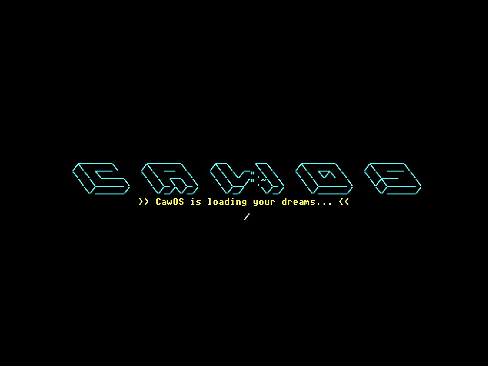
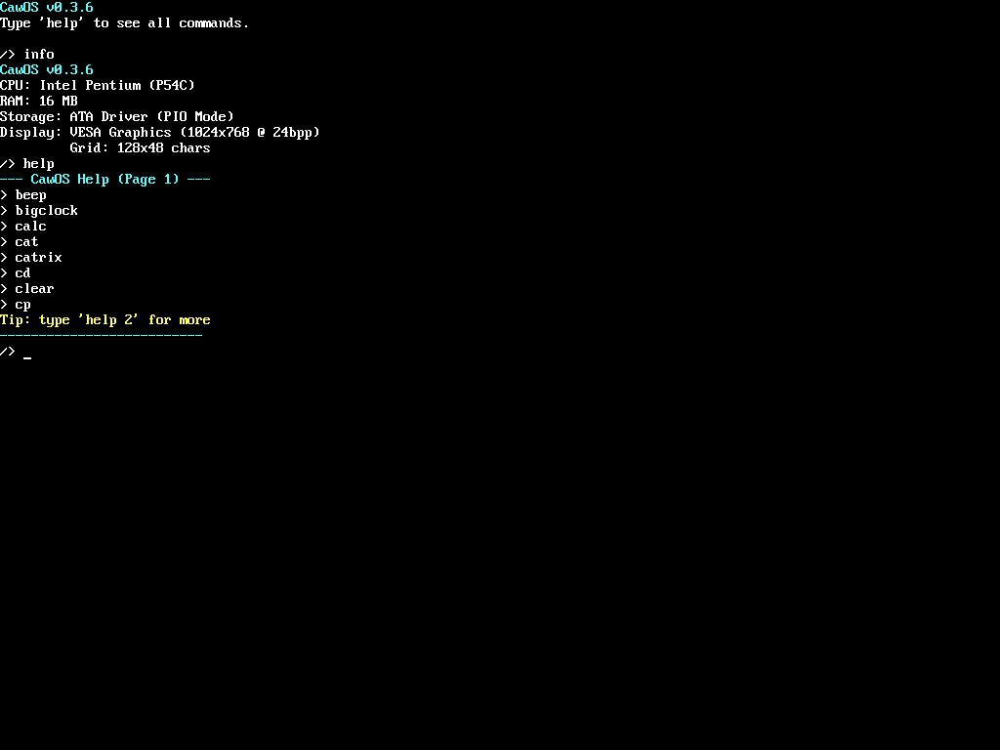

# CawOS

CawOS - 32-битная операционная система для x86. Написана на C и NASM, без сторонних библиотек. В репозитории лежат загрузчик, ядро, файловая система, консоль, графическая оболочка и пользовательские программы. Собирается под i486 и новее.

## Требования

- `i686-elf-gcc`, `i686-elf-ld`, `i686-elf-objcopy` в `PATH`;
- `nasm`;
- Python 3;
- `qemu-system-i386`;
- Linux, macOS или Windows.

Нужен именно кросс-компилятор. Обычный `gcc` не подойдёт: ядро собирается с `-ffreestanding -nostdlib` под `elf_i386`.

## Сборка

```bash
./build.sh          # Linux/macOS
```

```bat
build.bat           :: Windows
```

Обе команды вызывают `scripts/build.py`. Вручную:

```bash
python3 scripts/build.py
```

Скрипт делает всё по порядку:

1. компилирует пять программ из `src/elf` в `src/bin/elf`;
2. собирает `kernel_entry.asm` и `interrupt.asm` через NASM;
3. компилирует все `.c` из `src`, кроме `src/bin`, `src/elf` и `src/recovery`;
4. линкует `kernel.elf`, затем делает `kernel.bin`;
5. собирает `recovery.bin`;
6. копирует `src/bin` в `build/apps`;
7. создаёт `CawOS.img` на 16 МиБ и упаковывает в него CawFS;
8. пересчитывает `include/fs_config.h` под фактическое положение таблицы и данных.

Параметры сборки:

```text
--clean         удалить build/ перед сборкой
--no-programs   не пересобирать ELF-программы
-j N            число потоков компиляции
```

Пример:

```bash
python3 scripts/build.py --clean -j 8
```


## Запуск

```bash
./run.sh
```

```bat
start.bat
```

`run.sh` обёртка над `scripts/run.py`. По умолчанию: 256 МиБ ОЗУ, VGA std, COM1 в stdio, AC97.

Параметры `run.py`:

```text
--memory N      объём ОЗУ в МиБ (по умолчанию 256)
--serial DEV    backend последовательного порта (по умолчанию stdio)
--headless      запуск с -nographic
--no-audio      без AC97
--timeout N     остановить через N секунд, лог писать в serial.log
--log FILE      путь к логу
--extra ...     дополнительные аргументы QEMU
```

`run.py` подключает аудиодрайвер `dsound`, который есть только в Windows. На Linux и macOS запускайте `./run.sh --no-audio` или добавляйте свой `-audiodev` через `--extra`.

Вручную:

```bash
qemu-system-i386 -drive format=raw,file=CawOS.img,if=ide -m 256 \
  -vga std -serial stdio
```

При старте система ищет AC97 и, если находит, проигрывает `/core/res/audio/boot`. Удержание `DEL` в первые примерно 0.5 секунды загружает модуль Recovery вместо ядра.

## Отладка

Ядро всегда пишет журнал на COM1: этапы инициализации, версию, ошибки. При падении туда же уходит дамп BSOD с префиксом `[BSOD]`.

```bash
./run.sh --timeout 20 --no-audio        # serial.log будет записан
```

Для интерактивной работы через COM1 нужен `serial_console=1` в `/core/config/serial`. В поставляемом образе он включён: команды дублируются на COM1, ввод с COM1 обрабатывается как обычный.

## Устройство

### Загрузка

`boot.asm` занимает 512 байт и работает в реальном режиме. Через `INT 13h AH=42h` читает stage2 в `0x8000`, делает несколько попыток при ошибке и печатает код сбоя, если диск не отвечает.

`stage2.asm`:

- проверяет `DEL` по счётчику BIOS `0x046C`;
- включает A20 через порт `0x92`;
- перебирает режимы VBE: 1024×768, затем 800×600 и 640×480, глубина 16/24/32 бита, только с линейным фреймбуфером;
- при отсутствии VBE оставляет текстовый режим 80×25;
- загружает ядро или `recovery.bin` по LBA;
- включает свою GDT, переходит в защищённый режим, копирует ядро на `0x100000` и передаёт управление `kernel_entry.asm`.

### Ядро

Монолитное, драйверы работают в Ring 0. Пользовательские программы вынесены в Ring 3.

- GDT и TSS. TSS хранит `ESP0` для перехода Ring 3 → Ring 0.
- IDT: исключения, remap PIC 8259, PIT на 100 Гц, IRQ1 (клавиатура), IRQ12 (мышь), `int 0x80` для системных вызовов.
- Watchdog: если ядро не сбрасывает счётчик 500 тиков, выводится BSOD `WATCHDOG TIMEOUT`.
- Куча начинается с `0x00800000`. Свободная память проверяется записью паттернов с шагом 1 МиБ, затем `malloc`/`free` работают со списком блоков.
- Страничной адресации нет.

### Процессы

- Таблица на 16 процессов. PID 0 ядро, оно же idle.
- Вытесняющий round-robin. Квант 5 тиков, то есть 50 мс при 100 Гц.
- Состояния: `RUNNING`, `READY`, `ZOMBIE`. Завершённые процессы освобождаются в цикле оболочки.
- ELF-загрузчик: 32-битный i386, `ET_EXEC`, сегменты `PT_LOAD`, обнуление BSS.
- Программы линкуются на `0x01000000`, каждому процессу выделяется слот загрузки в 1 МиБ.
- Стек пользователя 64 КиБ, стек ядра 16 КиБ.

Процессами из консоли управляют `run` (запуск с ожиданием), `spawn` (фоновый запуск), `ps` и `kill`.

### CawFS

Табличная файловая система, устроенная похоже на FAT.

- Сигнатура `0xCA705`.
- Таблица на 1024 записи по 76 байт.
- CawFAT массив `uint16_t` на 32768 элементов.
- Кластер 512 байт.
- Поддерживаются каталоги, атрибуты файлов и флаг исполняемости.
- Таблица, CawFAT и область данных размещаются по LBA, которые вычисляет сборка.
- Чтение и запись идут через ATA PIO. Если ATA недоступен, используется BIOS `INT 13h` через переход Real ↔ Protected mode.

Служебный каталог `/core` защищён от удаления, переименования и форматирования. В нём лежат настройки: `shutdown`, `idle`, `font`, `serial`. Файл `serial.cfg` есть в репозитории (`src/bin/core/config/serial.cfg`), остальные создаются при работе. Упаковщик убирает расширения, поэтому внутри ОС они видны без `.cfg`.

### Графика и GUI

Кадр рисуется в теневой буфер `g_shadow` и затем копируется во фреймбуфер. Поддерживаются 16, 24 и 32 бита на пиксель.

Шрифты: встроенные 8×8 и 8×16, загрузка PSF, масштабирование. Команда `font` переключает шрифт и сохраняет выбор в `/core/config/font`.

Команда `gfx` запускает рабочий стол:

- панель задач с кнопкой CawOS и меню (Programs, Documents, Settings, Find, Explorer, Help, Run..., Log Off, Shutdown...);
- окна с заголовком, фокусом, перетаскиванием, закрытием и сворачиванием;
- кнопки окон на панели задач;
- иконки рабочего стола, обои BMP, выделение рамкой, двойной клик;
- часы в трее;
- встроенные приложения: `about`, `help`, `find`, `list`, `notepad`, `run`, `explorer`.

`Log Off` возвращает в консоль, `Shutdown` выключает машину через ACPI.

После заданного простоя включается экранная заставка с большими часами. Таймаут настраивается командой `idle`.

### Драйверы

- ATA/IDE PIO: primary/secondary, master/slave, LBA28.
- AC97: поиск на PCI (класс `0x04`, подкласс `0x01`), bus mastering через NAM/NABM, воспроизведение сырого PCM.
- PC Speaker: `beep` через PIT.
- PS/2 мышь: IRQ12, трёхбайтовые пакеты, ограничение курсора экраном.
- Клавиатура: IRQ1, скан-коды, Shift и Caps Lock.
- ACPI: поиск RSDP в EBDA и `0xE0000–0xFFFFF`, разбор RSDT/XSDT, FADT и MADT, выключение машины.
- CMOS RTC: дата и время.
- COM1: журнал ядра и, при `serial_console=1`, вторая консоль.

### Диагностика

BSOD выводится при делении на ноль, General Protection Fault, Page Fault и срабатывании watchdog. На экране: имя исключения, регистры `EIP`, `CS`, `EAX–EDX`, `ESP`, `EBP`, для Page Fault `CR2`, затем до восьми кадров стека по цепочке `EBP`. То же уходит на COM1 с префиксом `[BSOD]`.

Команда `panic` вызывает BSOD намеренно, чтобы проверить дамп и трассировку.

Recovery отдельный модуль без ядра. Проверяет 6 МиБ памяти в диапазоне `0x500000–0xB00000` паттернами `0x55555555` и `0xAAAAAAAA`, показывает результат на диагностическом экране. Перезапуск клавиша `R`.

## Скриншоты





## Лицензия

Apache License 2.0. Текст в файле [LICENSE](LICENSE).
